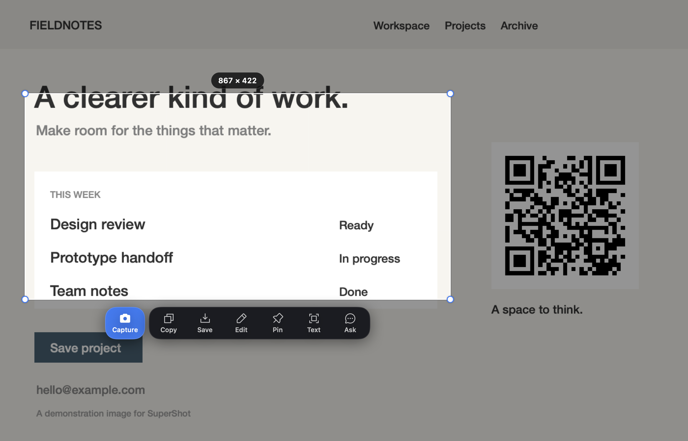
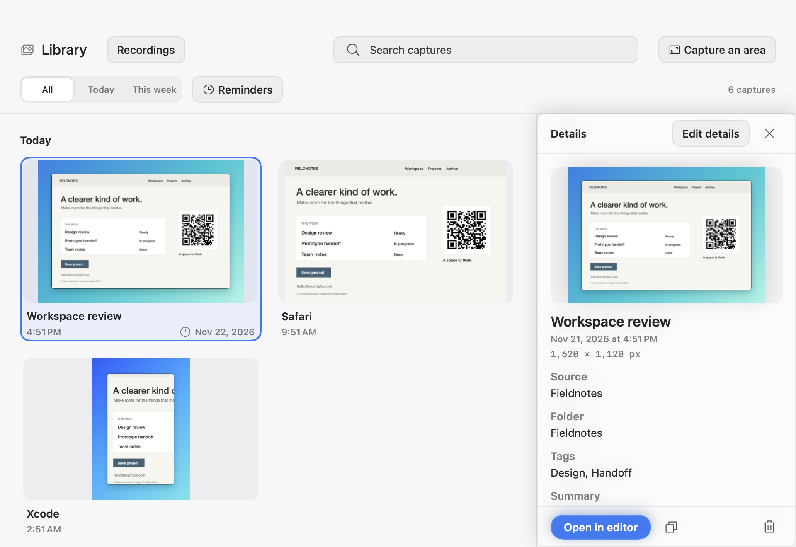
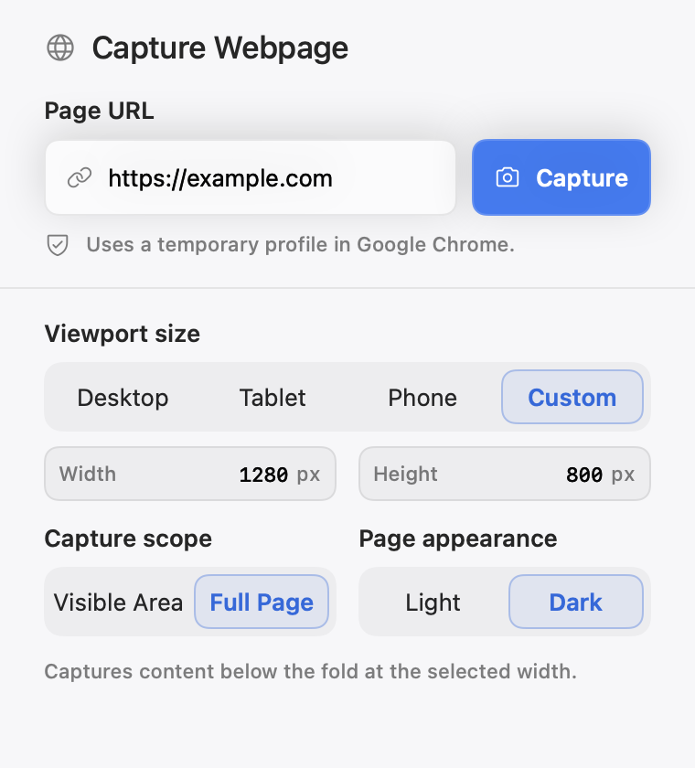
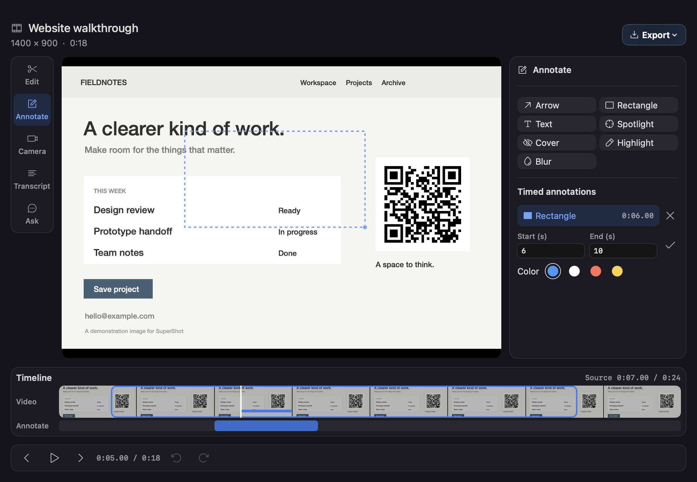
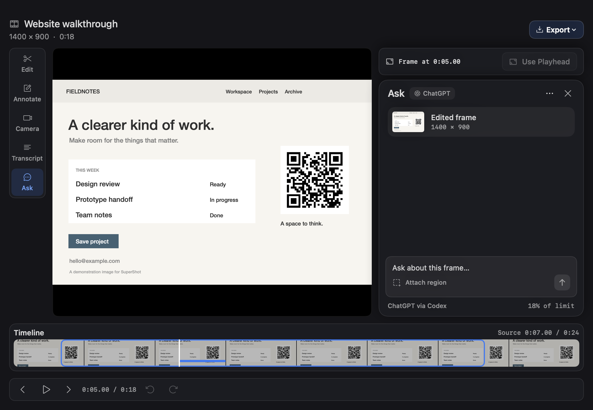
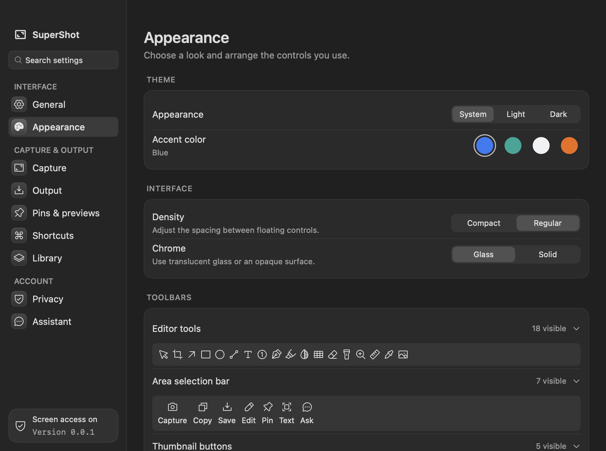

# SuperShot

**Capture, annotate, and record your Mac.** SuperShot puts screenshot tools in the menu bar, opens edits in a native Liquid Glass workspace, and keeps your captures in a searchable local Library.

[Download for Apple Silicon](https://github.com/desenyon/SuperShot/releases/latest) · [Changelog](CHANGELOG.md) · [Verification](docs/verification/2026-11-21-0.2.0.md)


## Get started

SuperShot requires **macOS 26 or newer**. Download the ZIP from GitHub Releases, unzip it, and move **SuperShot.app** to Applications. The downloadable build uses a local development signature and is unnotarized.

Open SuperShot from the menu bar and follow the optional capture practice. Grant Screen Recording access when you’re ready to capture. You can revisit the tour under **Help → Welcome Tour** or manage access in **Settings → Privacy**.

| Capture | Default shortcut |
| --- | --- |
| Display under the pointer | ⌃⇧⌘3 |
| Area | ⌃⇧⌘4 |
| Window | ⌃⇧⌘5 |

Find timed captures, all displays, scrolling capture, text recognition, QR scanning, and the previous area in the menu. Change bindings or import a profile in **Settings → Shortcuts**.

## Screenshots

| Capture | Organize |
| --- | --- |
|  |  |

- **Capture Area** lets you adjust a selection and then copy, save, edit, pin, or Ask. Enable **Capture on mouse release** to skip Return on a new drag. **Always copy** adds clipboard output alongside your other capture actions.
- **Capture Disposable Area** keeps a shot in the session. Reopen it from **Recent Captures**, or choose **Keep in Library** to save it.
- **Edit** with crop, arrows, shapes, freehand, text, counters, spotlight, magnifier, blur, and pixelation. Frame the image with a backdrop, shadow, padding, or watermark. Save the look as a reusable preset.
- **Export** to PNG, JPEG, HEIC, TIFF, PDF, or other formats supported by macOS. Save a `.supershot` project to reopen the editable layers later.
- **Pin** by dragging the image anywhere on a connected display. Click **Lock in place** or press **L**. Hold **Option** over the pin and click **Unlock**.
- **Library** searches recognized text and stores titles, folders, notes, tags, and reminders. Local organization suggestions are optional. **Settings → Output → Keep exported files updated** can link an automatically saved image to its editable project.

## Webpage capture and recording

| Webpage capture | Recording editor |
| --- | --- |
|  |  |

- **Capture Webpage** opens the URL in a temporary Chromium profile when you click **Capture**. Choose a viewport or full page, a preset or custom size, and light or dark page appearance. Requires Chrome, Chromium, Edge, or Brave.
- **Record Screen** captures a display, window, or area. Preview the source, choose the frame rate and resolution, and optionally record the cursor, system audio, microphone, or camera.
- **Recording Editor** supports trim, cuts, zoom, timed annotations and camera layouts, transcript edits, captions, and audio controls. Export MP4 or GIF, or save subtitles as SRT or WebVTT. On-device transcription depends on installed speech assets.
- **Share Review Link** uploads a flattened image or rendered recording to your configured server after confirmation. Guests can comment, react, mark an image, or leave timestamped video feedback. [Self-hosted setup](tools/review-links/README.md)

## Ask about a capture

Open **Ask** from the selection bar, thumbnail, or screenshot editor. In the recording editor, choose **Use Playhead** to prepare the edited frame. The video, audio, and transcript file stay on your Mac.



Install the [Codex CLI](https://github.com/openai/codex), then choose **Settings → Assistant → Sign in with ChatGPT**. The public build uses ChatGPT Ask. If you used Claude in an earlier version, select ChatGPT explicitly to turn Ask back on.

You can include recognized text, review a region attachment, or apply Smart Redact before sending. Ask shows the destination before the first upload when confirmation is enabled. It uses a read-only conversation and disables configured MCP servers for its Codex sessions.

## Settings



Choose System, Light, or Dark, change the accent and density, or use solid chrome. Reorder editor tools, selection actions, and thumbnail buttons. **Settings → Pins & previews** controls size, placement, opacity, and dismissal.

The screenshots above come from offscreen renders. They show the solid glass fallback used for previews.

## Build from source

```zsh
export EDITOR=vim VISUAL=vim GIT_EDITOR=vim
swift build
scripts/setup-signing.sh # first checkout only
scripts/bundle.sh
open dist/SuperShot.app
```

To stage a signed build without replacing the running copy, use `BUNDLE_OUTPUT_DIR="$PWD/dist/Updated" scripts/bundle.sh`. Keep `.local-signing/` private. Builds use Swift 6 and native Apple frameworks. [Third-party notices](THIRD_PARTY_NOTICES.md)

<details>
<summary>Automation and verification</summary>

Use these URLs from Shortcuts’ **Open URLs** action or the terminal.

```zsh
open 'supershot://capture?mode=area'
open 'supershot://capture?mode=area&delay=3'
open 'supershot://capture?mode=disposable'
open 'supershot://capture?mode=webpage'
open 'supershot://history'
open 'supershot://recent'
open 'supershot://record'
open 'supershot://recordings'
```

Capture modes also include `screen`, `window`, `all`, `previous`, `scrolling`, `text`, and `code`. Timed area capture accepts 3, 5, or 10 seconds. The URL scheme works with Command Line Tools builds. Native App Intent discovery requires an Xcode build with metadata extraction.

```zsh
scripts/test-background.sh
scripts/preview.sh
scripts/benchmark.sh
SUPERSHOT_TEST_WEBPAGE=1 scripts/test.sh --filter URLCapture
SUPERSHOT_LIVE_ASK=1 scripts/test.sh --filter Live
```

The opt-in live Ask tests use your signed-in plan. Offscreen tests and previews cover rendering, selection, local recognition, capture workflows, and exports. See the [verification report](docs/verification/2026-11-21-glass-audit.md) for coverage and the remaining macOS desktop checks.

</details>

Captures are stored under `~/Library/Application Support/SuperShot`. Editable projects preserve the original pixels. Share a flattened export when you want redactions baked into what recipients see.
