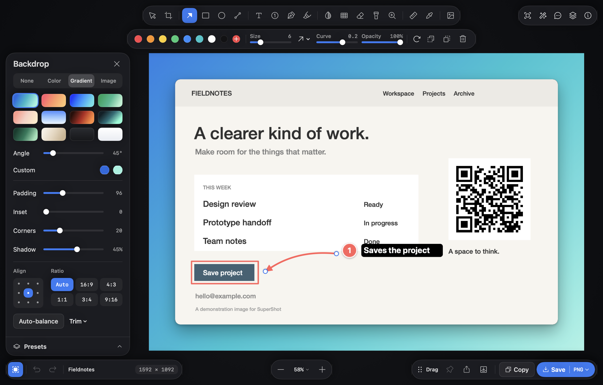
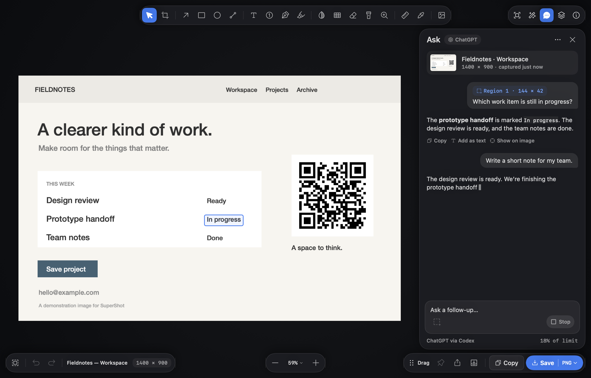

# SuperShot

A native macOS screenshot editor with floating Liquid Glass controls, editable annotations, backdrops, local OCR, a searchable capture library, and **Ask**: chat about any capture with your own ChatGPT or Claude plan. Requires macOS 26 or newer. Built with Swift 6 and Apple frameworks, with no third-party code dependencies. Interface icons are Phosphor (MIT, embedded as SVG; see [THIRD_PARTY_NOTICES.md](THIRD_PARTY_NOTICES.md)). SuperShot itself makes no network calls; Ask hands questions to the Codex or Claude Code CLI on your Mac, only when you send one.



Images in `docs/previews/` are rendered offscreen by `scripts/preview.sh`. Floating surfaces use Liquid Glass in the running app and appear opaque in these renders.

## Release 0.1.0

Ask about any capture, a new logo and icon set, a purple-free palette with a choice of accent, much more customization, motion across the app, and modernized Settings, editor, pins, and Library. Version **0.1.0**, build **7**. See [CHANGELOG.md](CHANGELOG.md) for the full list and the [0.1.0 verification report](docs/verification/2026-11-18-0.1.0.md) for checks and remaining live verification.



### Ask

Ask a question about a capture and get an answer next to it:

- **Editor:** the Ask tab in the right panel. Attach a region with the dashed-square button, stop a reply with Stop, and use Copy, Add as text, or Show on image on any answer.
- **Right after a capture:** choose **Ask** on the area-selection bar, or the Ask button on the quick-access thumbnail. A chat panel opens beside the thumbnail; Open in editor carries the conversation over.

Ask uses a subscription you already have through a command-line tool on this Mac. SuperShot never sees a password, token, or API key; each tool owns its own sign-in.

| Provider | Tool | Sign in |
|---|---|---|
| ChatGPT (default) | [Codex CLI](https://github.com/openai/codex) `codex app-server` | Settings → Assistant → Sign in with ChatGPT opens your browser |
| Claude | [Claude Code](https://claude.com/claude-code) `claude -p` | Settings → Assistant → Sign in opens Terminal with `claude auth login` |

Before the first upload in a conversation, Ask says which company receives the image (OpenAI or Anthropic). You can include on-device recognized text, blur sensitive details first with Smart redact, and keep conversations with captures in History. Conversations run read-only: the tools are started with commands, file edits, plugins, and MCP servers disabled. Set the provider to **Off** to hide Ask everywhere.

### Customize

Settings → Appearance: System, Light, or Dark; accent (blue, teal, graphite, or tangerine); compact or regular density; glass or solid floating chrome; and the order and visibility of editor tools, area-selection buttons (with or without labels), and thumbnail buttons.

## Run locally

```zsh
export EDITOR=vim VISUAL=vim GIT_EDITOR=vim
swift build
scripts/setup-signing.sh # first checkout only; skip when .local-signing already exists
scripts/bundle.sh
open dist/SuperShot.app
```

The bundle script builds an optimized release by default and refuses to replace a running app. To stage an update while working, run `BUNDLE_OUTPUT_DIR="$PWD/dist/Updated" scripts/bundle.sh`. Quit SuperShot normally before installing the staged bundle; this flushes pending editor saves. The bundle script stages and verifies the new app before replacing the previous bundle. A stable local signing certificate preserves its code identity across rebuilds. This is a development signature, not a notarized distribution build. Keep `.local-signing/` private.

Allow Screen Recording from the one-time setup or Settings → Privacy. Closing setup marks it as seen; reopening the app opens Settings instead of repeating setup. SuperShot lives in the menu bar by default; Settings can enable a Dock icon or launch at login.

| Capture | Default shortcut |
|---|---|
| Screen under the pointer | Control–Shift–Command–3 |
| Area | Control–Shift–Command–4 |
| Window | Control–Shift–Command–5 |

All capture actions are available from the menu. Settings → Shortcuts records replacements, detects conflicts, and imports/exports profiles. The system screenshot preset explains how to disable conflicting macOS shortcuts.

## Included

- Screen, window, frozen area, previous area, timed, all-display, text, barcode, and vertical scrolling capture flows. Manual scrolling is the default; optional automatic scrolling requests Accessibility access when enabled.
- Independent copy/save/editor/thumbnail/pin actions; a separate area-capture preference. Settings → Capture → Quick capture adds **Automatically copy screenshots** (copies alongside other actions, including area capture) and **Capture on mouse release** (skip Enter for a new area drag). Both switches default off. Escape cancels; clicks and zero-area drags do not capture. Text, barcode, and scrolling workflows retain their existing confirmation behavior.
- Non-destructive crop and annotation layers: arrows, shapes, text, drawing, highlighter, counters, spotlight, magnifier, blur, pixelation, color erase, ruler, and pasted images. Undo/redo, selection transforms, zoom, color picking, and image metadata.
- Transparent, solid, gradient, and wallpaper backdrops; twelve built-in multi-stop gradients with adjustable angle; padding, inset frame, rounded corners, shadows, alignment, aspect presets, trimming, balancing, and reusable presets.
- Runtime-supported image formats, PDF, clipboard format, 1× export, color-profile settings, filename templates, and optional editable `.supershot` sidecars.
- Local Vision OCR and codes, smart-redaction review, subject lifting, text extraction, and OCR-indexed history. Conditional Apple Intelligence and installed-language translation actions report availability. Patch erase and 2×/4× resampling are explicitly labeled.
- Floating pins with native image dragging, aspect-preserving edge/corner resizing, double-click size reset, opacity and click-through lock. Arrow keys move a focused pin; +/− resize and 0 restores its size. Unlock pins from the menu bar.
- Settings → Pins & previews controls thumbnail corner, width, auto-dismiss interval, and new-pin size, opacity, shadow, and Space visibility. The thumbnail dismissal timer pauses under the pointer.
- Searchable settings navigation, native sharing, image drag/drop, retention settings, shortcut profiles, and URL automation.

- Ask about a capture through ChatGPT (Codex) or Claude (Claude Code), with region attachments, streaming replies, consent before upload, optional redaction, and conversations kept with captures in History.
- Settings → Appearance for accent, density, chrome, and toolbar contents; one motion system for panels, tools, thumbnails, messages, and windows that reduces to crossfades under Reduce Motion.

Original pixels remain in editable projects and history. Share a flattened exported image when redacting content. Nothing is uploaded unless you send an Ask question; then the image goes to the provider you chose.

## Automation

Use these with Shortcuts' **Open URLs** action or the terminal:

```zsh
open 'supershot://capture?mode=area'
open 'supershot://capture?mode=screen'
open 'supershot://capture?mode=scrolling'
open 'supershot://capture?mode=area&delay=3'
open 'supershot://history'
```

Other capture modes: `window`, `all`, `previous`, `text`, and `code`. A delay of 3, 5, or 10 seconds starts a timed **area** capture. Open an image or project through the menu, drag it onto an editor, or run `open -a "$PWD/dist/SuperShot.app" /path/to/image.png`.

Native App Intent declarations are included, but this Command Line Tools installation has no metadata extractor. Native Shortcuts action discovery is not verified; the URL scheme is the supported local automation route.

## Verification and current limits

```zsh
scripts/test-background.sh # offscreen checks while using the Mac
scripts/preview.sh         # render every screen to docs/previews without showing a window
scripts/test.sh
scripts/benchmark.sh
```

The background command uses lower CPU priority and two build jobs, and excludes the recorder-window test. It checks document editing, rendering snapshots, synthetic scrolling frames, local OCR/QR, export, history, and settings without launching SuperShot or interacting with the desktop. It is not a macOS VM: live capture, permissions, focus, and visual appearance still require a separate macOS desktop or a scheduled interactive session. Keep desktop-dependent tests out of this command as coverage grows.

The test wrapper handles this machine's Swift Testing plugin discovery. Benchmarks use a synthetic 5120×2880 image with 200 vector annotations; they do not establish full interactive-canvas or effect-heavy frame rates.

See the [0.1.0 verification report](docs/verification/2026-11-18-0.1.0.md) for this release. See the [quick capture update](docs/verification/2026-11-16-quick-capture.md) for auto-copy, release-to-capture, and the latest regression checks. See the [settings and pins update](docs/verification/2026-11-16-settings-pins.md) for the latest checks. See the [verification report](docs/verification/2026-11-16.md) for test results, measured timings, audit fixes, UI screenshots, and unverified flows. The broader product specification in [AGENTS.md](AGENTS.md) is still the roadmap. This build does not include downloadable generative models, API-key cloud providers, horizontal stitching, video/GIF recording, or cloud share links.

Data is stored locally under `~/Library/Application Support/SuperShot`. Preferences use the `dev.desenyon.SuperShot` defaults domain. Imported originals and project layers are preserved; history retention is configurable.
