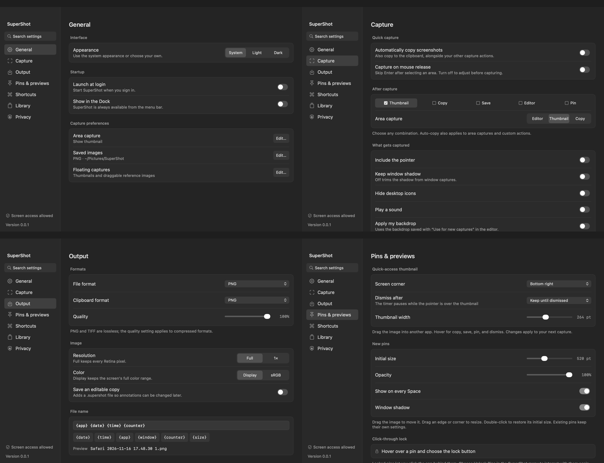
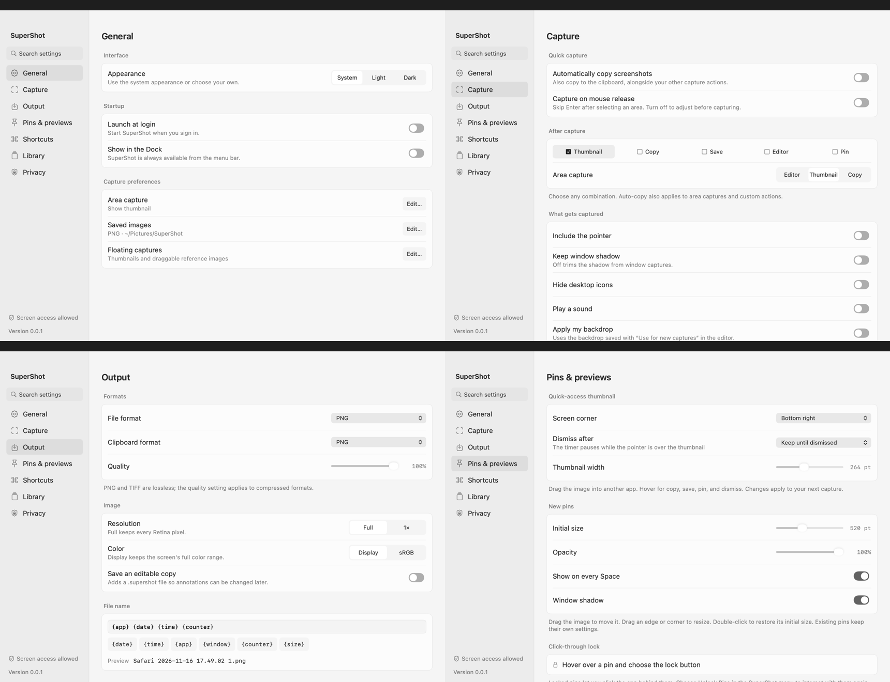
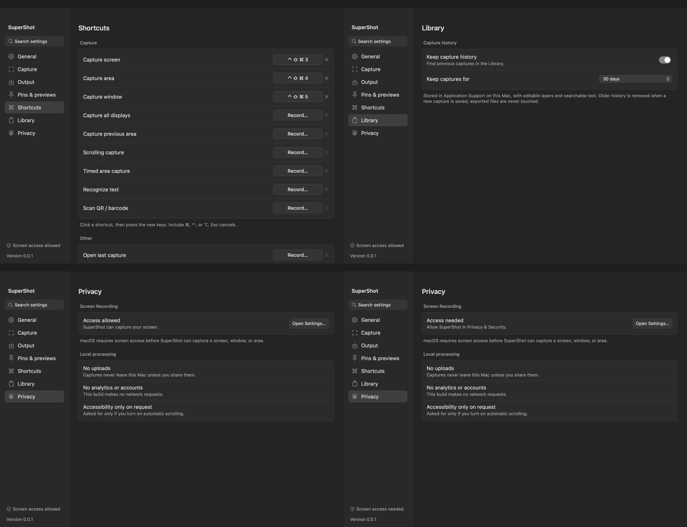
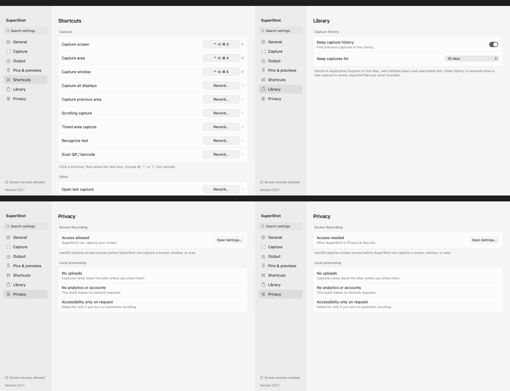

# Settings redesign — SuperShot 0.0.1

All seven Settings pages now use a compact graphite design system. The editor, capture overlays, welcome screen, thumbnails, and pin interface were outside this redesign. No preference keys, defaults, persistence schema, capture actions, or shortcut assignments were changed.

## Page audit

| Page | Final layout and controls |
|---|---|
| General | Smaller header, compact appearance segments, startup rows, small Edit buttons for related preferences. |
| Capture | Two quick-capture switches, multiple after-capture actions as compact checkboxes, separate area choice, grouped capture options and per-mode overrides. |
| Output | Aligned native format menus, native quality slider, resolution/color segments, editable filename tokens, a quiet filename preview, and a truncated folder path with full-path help. |
| Pins & previews | Consistent native menus and sliders, numeric values on the control grid, grouped pin defaults, and retained click-through instructions. |
| Shortcuts | Compact key displays with neutral recording/focus outlines, separate editor keys, profile import/export rows, system-key setup and restore actions. Long preset labels wrap without displacing the recorder. |
| Library | History and retention in one compact group; storage and retention explanations remain available. |
| Privacy | Quiet permission row and smaller System Settings action; no colored shield or status dot. Local-processing explanations remain intact. |

The 172-point sidebar uses `NSVisualEffectView` with the semantic sidebar material and behind-window blending. Grouped content uses SwiftUI's native regular material. Settings tokens are isolated in `DS.Preferences`; the editor's accent is unchanged. Reduce Transparency uses explicit opaque light/dark colors. Increased Contrast strengthens group boundaries. There are no synthetic gradients or decorative shadows in Settings.

Shared controls retain labels and native keyboard behavior where applicable. Buttons and fields have neutral focus outlines; toggles have a semantic Toggle accessibility representation. Dropdowns use actual `NSPopUpButton` controls. Sliders use native SwiftUI tracking and keep mouse-drag drafts local until release. Shortcut capture/cancellation and the existing global-hotkey suspension callbacks are preserved.

## Verification

- `scripts/test-background.sh`: **76 tests passed across 11 targets**, no test failures. Includes settings defaults/round trips, action resolution, export/clipboard regression checks, rendering, capture geometry, recognition, and the new detached neutral-shortcut-recorder capture/cancellation test. See [test output](settings-0.0.1-evidence/tests.log).
- `PREVIEW_ONLY=settings scripts/preview.sh`: **62 offscreen scene PNGs** generated, including every tab in both appearances, 680-point narrow layouts, full-content layouts, opaque accessibility fallbacks, long folder paths/preset names, shortcut conflict text, and permission-denied state. See [preview output](settings-0.0.1-evidence/previews.log).
- Inspected all seven tabs in light/dark, their narrow layouts, and the accessibility fallback review sheets. Iterations corrected dropdown width/alignment, light-mode recorder borders, search typography/focus, toggle contrast, and long-path layout.
- Source audit found every original preference binding retained and no remaining editor-accent, purple switch, colored permission-dot, or old action-tile styling in Settings.
- Release build **0.0.1 (6)** completed for Apple Silicon; stable local development signature verified with `codesign --verify --deep --strict`. See [bundle output](settings-0.0.1-evidence/bundle.log).

## Visual evidence

These are actual offscreen renders, not design mockups. Glass uses the documented opaque fallback because there is no onscreen backdrop to sample.

The individual `settings-*.png` files in [previews](../previews/) include full-content and narrow variants. `settings-review-narrow-*` and `settings-review-access-*` collect the resizing and accessibility checks.

## Boundaries

No application was brought forward, restarted, or installed during these checks. No desktop input, real capture, permission prompt, or shared-clipboard write was performed. The recorder-window test remains excluded by the background wrapper.

Live vibrancy, active-window focus traversal, native popup interaction, VoiceOver traversal, OS permission integration, and actual screen capture remain pending an isolated macOS desktop or an explicitly authorized interactive session. Offscreen previews and passing tests do not establish those results. The downloadable build is locally development-signed, not Apple-notarized.

## API references

The material implementation follows Apple's [NSVisualEffectView documentation](https://developer.apple.com/documentation/appkit/nsvisualeffectview), including semantic sidebar material and blending modes. AppKit recorder colors resolve against the view's current appearance using [performAsCurrentDrawingAppearance](https://developer.apple.com/documentation/appkit/nsappearance/performascurrentdrawingappearance(_:)).
