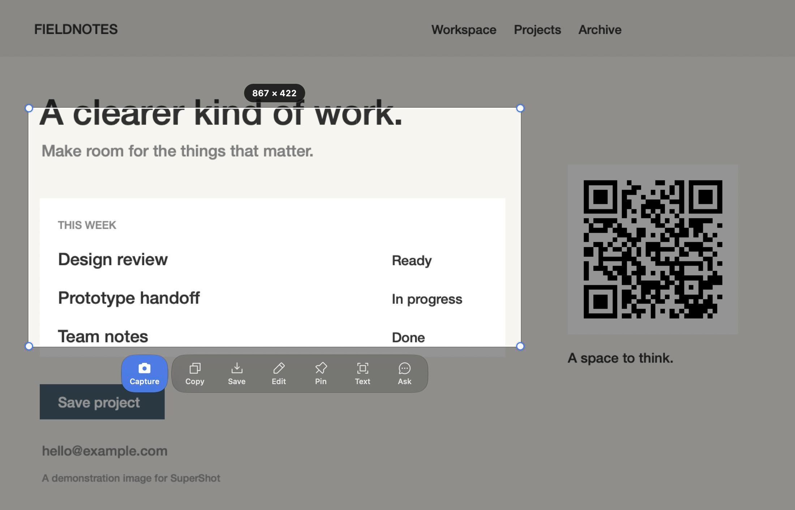
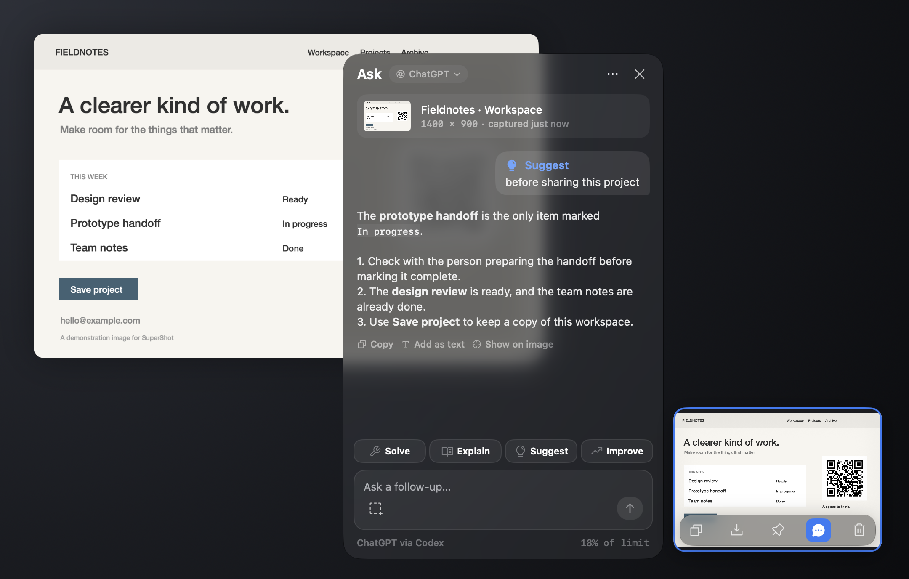
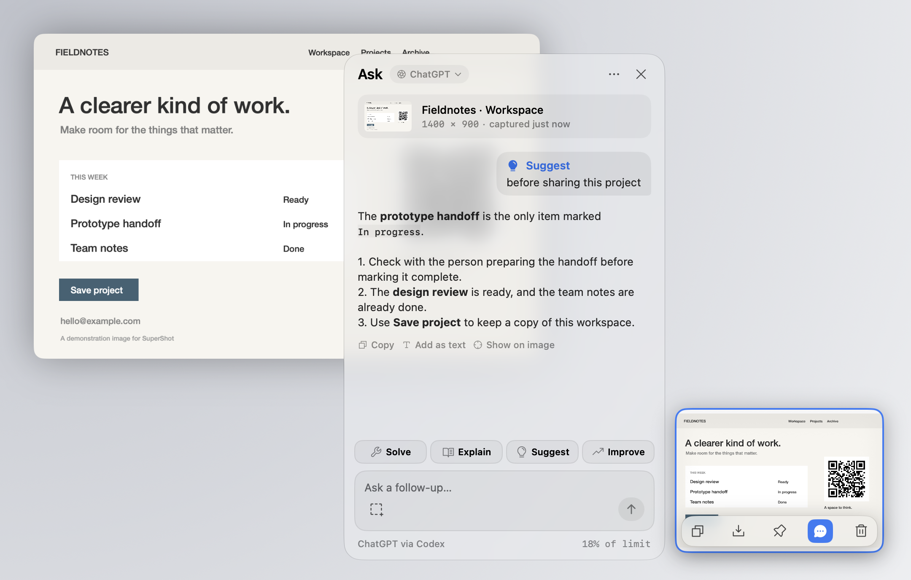
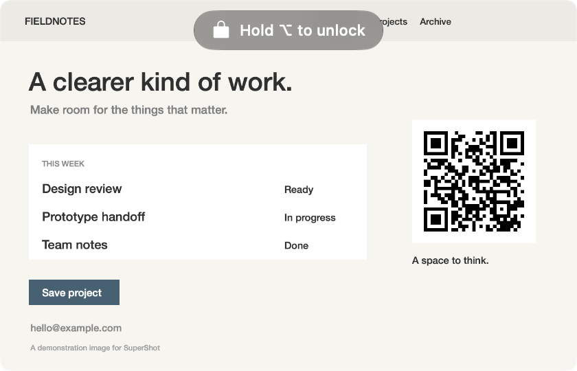
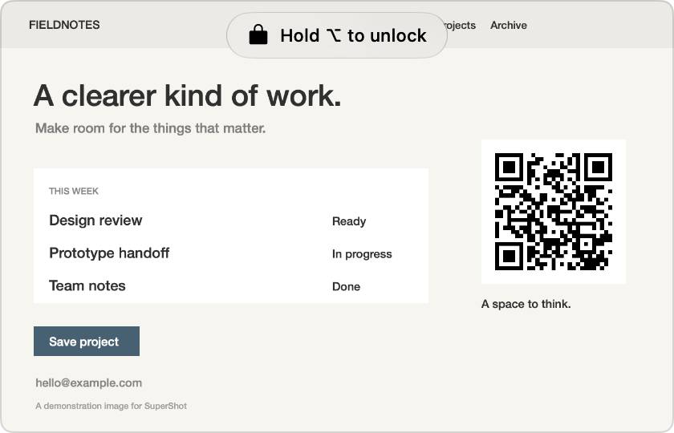
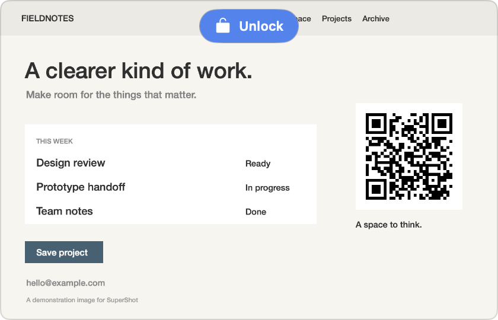
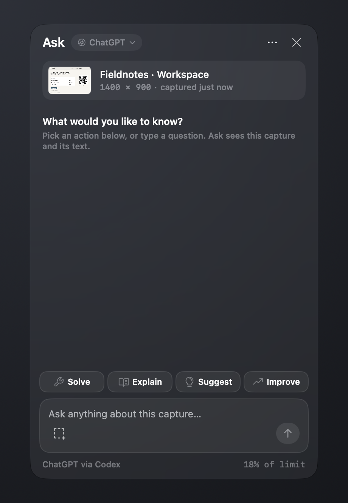
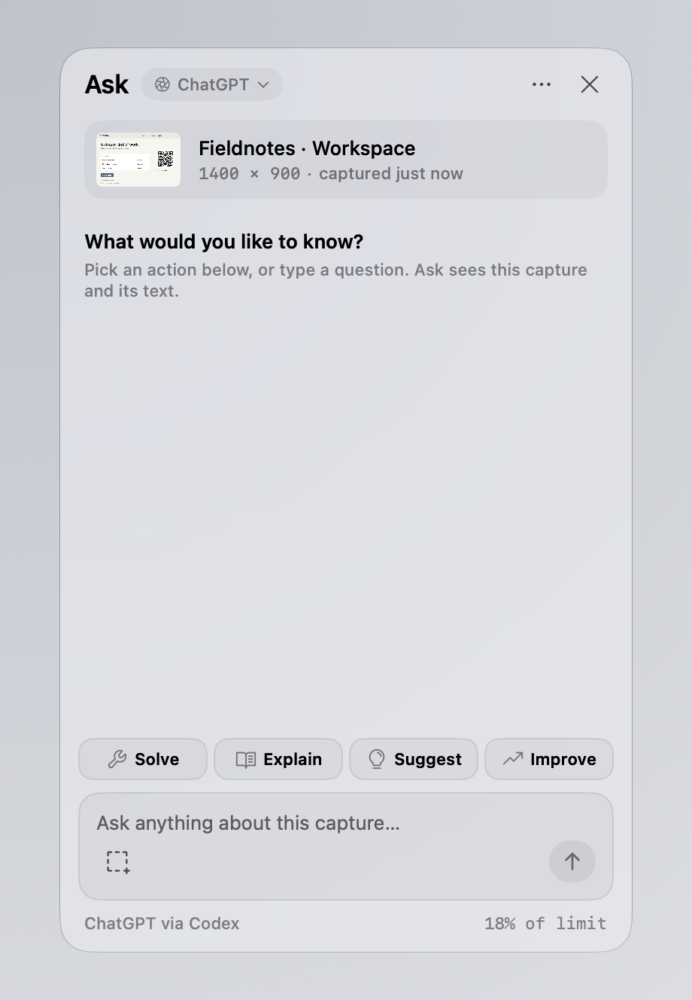
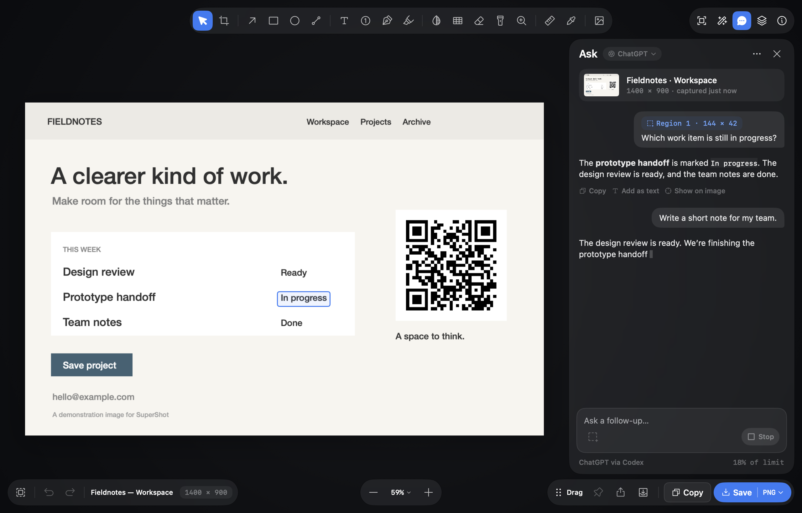
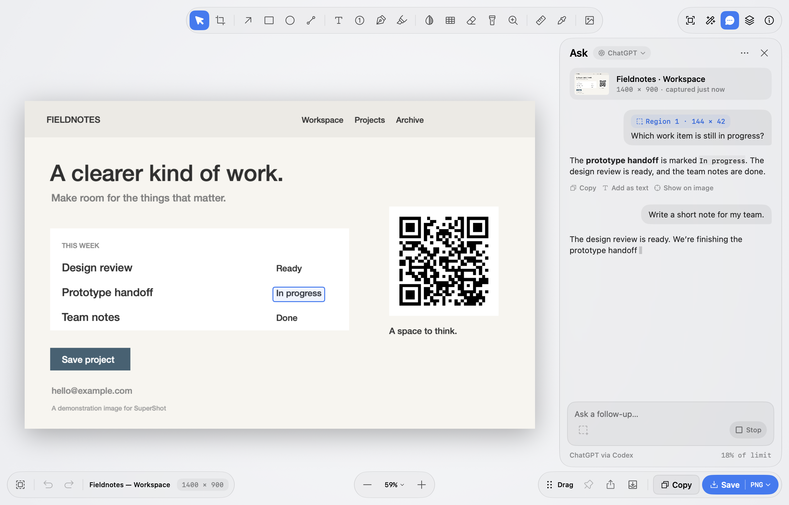

# SuperShot 0.1.1 verification

Date: 2026-11-18. Version 0.1.1, build 8.

## Ask with ChatGPT

**Reproduced:** driving `codex app-server` (codex-cli 0.169.0) by hand with SuperShot's 0.1.0 launch arguments showed the user's three configured MCP servers (`ibkr`, `yab-browser`, `node_repl`) starting despite `-c mcp_servers={}`. `mcpServerStatus/list` reported them as `authenticationRequired`, `failed`, and `connected` (with four tools). SuperShot's pre-turn safety check therefore refused every conversation.

**Confirmed fix:** passing `config: { mcp_servers: { <name>: { enabled: false } } }` in `thread/start`, with names read from `config/read`, left every server at runtime status `disabled` with no tools and no startup events. A per-server `-c mcp_servers.<name>.enabled=false` launch flag behaves the same, but needs a restart whenever the config changes, so the per-thread form was chosen. `codex app-server --disable <unknown>` exits with "Unknown feature flag", so disabled features are now intersected with `codex features list`.

**Live tests** (opt-in, run against the signed-in Codex on this Mac):

| Test | Result |
|---|---|
| `LiveAssistantTests.chatGPTThroughCodexAnswersAndFollowsUp` | Passed. "What is the large headline?" → "The large headline is “A clearer kind of work.”"; the follow-up kept thread context → "work" |
| `LiveAskModelTests.askModelGetsARealReplyThroughCodex` | Passed. Rendered document → upload confirmation → streamed reply "A clearer kind of work."; the **Explain** quick action then returned a full explanation in the same conversation |

Claude Code was not exercised live (`SUPERSHOT_LIVE_CLAUDE=1` was not set).

## Automated tests

`scripts/test-background.sh`: **127 tests across 11 targets passed**; the 3 live tests are skipped there by design. New coverage: per-thread MCP disabling and the live-server check (fixture and fake-executable end-to-end), feature-list parsing, quick-action prompts and bubbles, consent cancellation for actions, suggestion migration, and `FloatingPreferences` decoding with the new unlock key.

## Liquid Glass, captured live

`SuperShot --live-preview` from the signed bundle showed each surface in a real window for about a second and captured it with ScreenCaptureKit. Captures in [`0.1.1-glass/`](0.1.1-glass/):

| Surface | Dark | Light |
|---|---|---|
| Area-selection bar |  |  |
| Thumbnail with Ask panel |  |  |
| Locked pin, hover hint |  |  |
| Locked pin, unlock key held |  |  |
| Ask, empty conversation |  |  |
| Editor with Ask |  |  |

The first live capture showed that system glass tints too faintly for a primary control: the accent Capture and Unlock pieces read as gray. Tinted glass now carries a solid tint layer inside its shape, and the recapture shows blue glass buttons.

## Offscreen renders

`scripts/preview.sh` re-rendered all **146 PNGs** in `docs/previews/`, including the new `ask-empty`, `ask-thinking`, `pin-locked-hint`, and `pin-locked-unlock` scenes and the Pins & previews page with the Click-through lock group.

## Still pending

- Moving the pointer over a real locked pin and holding the unlock key, end to end on the desktop. The badge states and the polling logic are covered above; the pointer interaction itself was not driven.
- The area-selection bar inside a real capture overlay, triggered by the hotkey. The live capture uses the same view in a preview window over a frozen fixture.
- Claude Code live replies.
